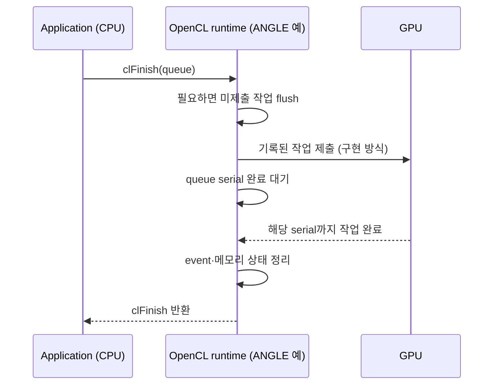

> **정정 · 2026-10-15**: 이 글은 과거에 `clFinish`가 반드시 `VkFence`를 만들고 `vkWaitForFences`로 기다리며, `IT_EVENT_WRITE(CACHE_FLUSH_AND_INV)`가 fence 값을 쓴다고 설명했습니다. 이는 OpenCL의 API 보장과 특정 구현의 동작을 섞은 잘못된 일반화였습니다. 아래 본문과 애니메이션을 수정했으며, GFX9 compute ring의 fence 기록 예는 `RELEASE_MEM`으로 바로잡았습니다.

`clFinish(queue)`의 핵심은 간단합니다. **해당 command queue에서 앞서 enqueue된 명령의 완료를 기다린다.** CPU가 어떤 Vulkan 객체로 기다리는지, GPU가 어떤 PM4 패킷으로 완료를 기록하는지는 이 API가 정하지 않습니다.

> OpenCL 사양: “blocks until all previously queued OpenCL commands in a command-queue are issued to the associated device and have completed.” 즉 해당 큐의 이전 명령이 디바이스에 제출되고 완료될 때까지 호출자가 기다립니다. 다른 큐까지 전부 idle이어야 한다는 뜻은 아닙니다. [Khronos OpenCL API 사양 — Flush and Finish](https://registry.khronos.org/OpenCL/specs/unified/html/OpenCL_API.html#_flush_and_finish)



## 전체 흐름: 보장과 구현 예를 분리하기

```text
OpenCL 앱: clFinish(queue) 호출
  → 런타임: 그 큐의 미제출 명령이 있다면 제출되도록 진행
  → 디바이스: 해당 큐의 이전 명령 완료
  → 런타임: 완료를 확인하고 호출자에게 반환
```

ANGLE의 Vulkan backend에서는 `finishInternal()` 경로에서 필요하면 명령을 flush하고 **queue serial**의 완료를 기다립니다. `finishQueueSerialInternal()`은 완료 후 관련 메모리 객체와 event 상태도 정리합니다. 이것은 구현 예이지 `clFinish = VkFence 생성`이라는 API 계약이 아닙니다. [ANGLE `CLCommandQueueVk.cpp`](https://github.com/google/angle/blob/main/src/libANGLE/renderer/vulkan/CLCommandQueueVk.cpp)



대기 중 host thread가 실제로 sleep하는지, 잠시 polling하는지, 어떤 OS primitive를 쓰는지는 구현과 상황에 달려 있습니다.

## Vulkan의 Fence·Semaphore·Event는 각각 무엇인가

이 셋은 **Vulkan 동기화 도구의 예**이지 OpenCL 함수와 일대일로 짝지어지는 물건이 아닙니다.

| Vulkan 도구 | 대표적인 역할 | 주의할 점 |
|---|---|---|
| `VkFence` | host가 queue 제출 완료를 확인·대기 | 어떤 OpenCL `clFinish`도 반드시 새 `VkFence`를 만들 필요는 없음 |
| `VkSemaphore` | queue 제출 사이의 GPU-side 의존성 | OpenCL event wait-list와 일대일 대응하지 않음 |
| `VkEvent` | command buffer 안에서 설정·대기하는 device-side 동기화 | OpenCL event나 user event와 다른 객체 |

예를 들어 Vulkan 애플리케이션은 `vkQueueSubmit`에 `VkFence`를 연결하고 `vkWaitForFences`로 기다릴 수 있습니다. **이것은 가능한 Vulkan 패턴**이지 ANGLE의 `clFinish` 호출 순서를 재현한 코드는 아닙니다. semaphore는 제출 사이 의존성, event는 command buffer 내부 의존성 표현에 쓰일 수 있지만, 실제 OpenCL backend의 선택은 별도로 확인해야 합니다.

## PM4 수준: GFX9 compute ring의 fence 기록 예

OpenCL API 호출에서 특정 PM4 opcode로 곧장 내려가는 고정된 대응은 없습니다. AMDGPU의 **GFX9 compute ring fence 방출 경로**에서는 KMD가 `PACKET3_RELEASE_MEM`을 사용해 지정한 주소에 fence sequence 값을 기록합니다. 이 완료 기록은 host가 제출된 작업의 진행을 추적하는 데 쓰입니다. [Linux amdgpu `gfx_v9_0.c`](https://github.com/torvalds/linux/blob/master/drivers/gpu/drm/amd/amdgpu/gfx_v9_0.c)

```text
GFX9 compute ring의 한 예:
  이전 작업 진행 → KMD가 넣은 RELEASE_MEM 실행
  → fence 주소에 sequence 값 기록 → 대기 경로가 완료를 관찰
```

기존 글의 `IT_EVENT_WRITE(CACHE_FLUSH_AND_INV)` 패킷 예시는 **이 fence 값 기록의 설명으로 틀렸습니다.** `EVENT_WRITE`의 cache event와 fence sequence 쓰기를 동일시하면 안 됩니다. cache 가시성 요구와 완료 신호는 관련될 수 있지만 서로 같은 동작이 아니며, 실제 패킷·대기 경로는 GPU 세대, ring 종류, 드라이버 구현에 따라 달라집니다.

## OpenCL 관점 정리

| OpenCL API | 사양이 보장하는 것 | 구현 예·주의점 |
|---|---|---|
| `clFinish(queue)` | 그 큐의 이전 명령을 제출하고 완료까지 기다림 | ANGLE은 queue serial 대기 경로 사용. `VkFence` 생성은 필수가 아님 |
| `clFlush(queue)` | 그 큐의 이전 명령이 **언젠가** 디바이스에 제출되도록 함; 완료 대기 아님 | Vulkan backend에서 제출 호출이 필요할 수 있지만 `clFlush = vkQueueSubmit 한 번`은 아님 |
| `clWaitForEvents(events)` | 지정한 event들의 완료를 기다림 | OpenCL event가 곧 `VkEvent`라는 뜻이 아님 |
| `clEnqueueBarrierWithWaitList` | 해당 큐의 명령 의존성을 형성 | Vulkan barrier·동기화 명령의 조합은 구현에 따름 |

핵심 구분은 **완료를 기다리는 OpenCL 계약**, **Vulkan backend가 선택한 대기 메커니즘**, **AMDGPU가 완료를 기록하는 패킷**입니다. 세 층을 같은 이름의 “fence” 하나로 합치면 디버깅할 때 길을 잃기 쉽습니다.

---

## 관련 글

- [vkCmdPipelineBarrier 깊이 파기](/vulkan-pipeline-barrier/) — GPU 내부 순서와 메모리 의존성
- [PM4 Indirect Buffer](/pm4-indirect-buffer/) — IB에 담기는 PM4 흐름
- [PM4 제출 흐름](/pm4-submit-flow-animation/) — ring buffer와 제출 경로

## 관련 용어

[[command-queue]], [[command-buffer]], [[ring-buffer]], [[pm4-packet]]
