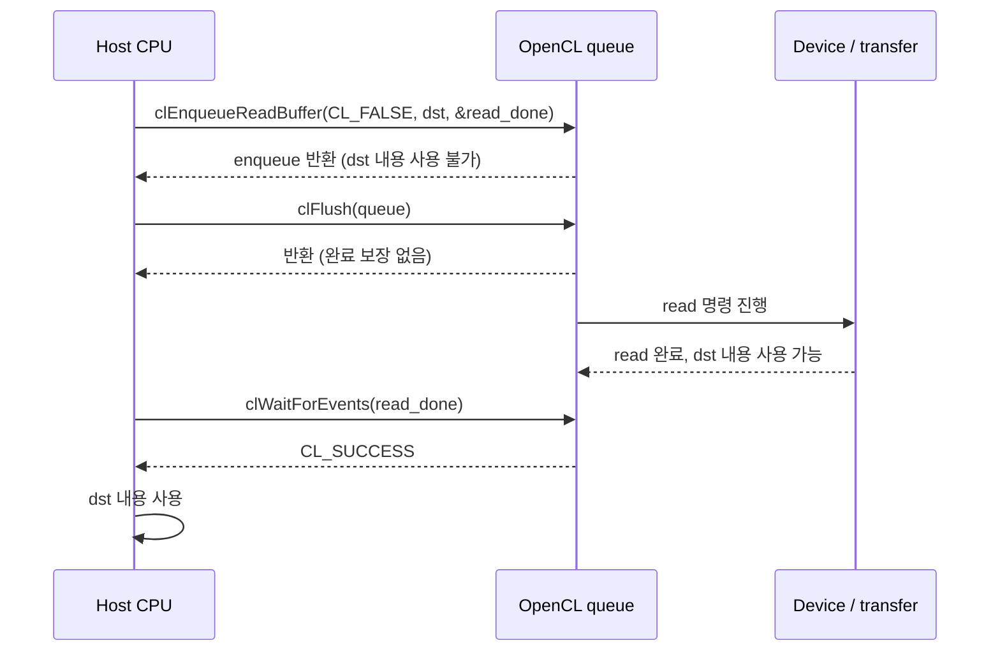

10월 12일 퀴즈에서 `clEnqueueReadBuffer(..., CL_FALSE, ..., dst, ...)` 뒤 `clFlush(queue)`만 호출하면 `dst`의 새 값을 읽어도 된다고 답했다. 9월 15일에는 같은 목적지의 **완료 전 접근 금지**를 설명했으므로, 한 번의 흔들림을 고착된 오개념으로 단정할 수는 없다. 그래도 이 경계는 driver 디버깅에서 치명적이다. `clFlush`가 성공했는데 CPU가 옛 값을 봤다면, 먼저 “GPU→host copy가 완료됐나?”를 물어야 한다.

택배 비유로 `enqueue`는 배송 접수, `clFlush`는 창고에서 배송망으로 내보내기, read event의 성공적 완료는 물건이 목적지에 도착한 상태다. 출발 처리가 끝났다고 현관의 상자를 열 수는 없다. **비유의 한계:** 실제 OpenCL 명령은 queue dependency·device 실행·host copy가 얽히며, 구현의 물리적 제출 시점은 이 세 단어로 딱 잘리지 않는다. 여기서 구분하는 것은 API가 보장하는 경계다.

## 먼저 확정된 코드 사실

- Khronos OpenCL-Docs `api/opencl_runtime_layer.asciidoc`의 `clEnqueueReadBuffer` 설명은 `blocking_read = CL_FALSE`이면 명령을 queue에 넣고 반환하며, **“The contents of the buffer that _ptr_ points to cannot be used until the read command has completed.”**라고 명시한다. 한국어로는 “read 명령이 완료될 때까지 `_ptr_`이 가리키는 목적지의 내용을 사용할 수 없다”는 뜻이다. 완료 후에는 앱이 그 내용을 사용할 수 있다. Source: [OpenCL-Docs, L1059–1070](https://github.com/KhronosGroup/OpenCL-Docs/blob/main/api/opencl_runtime_layer.asciidoc#L1059-L1070).
- 같은 파일의 `clFlush` 설명은 **“There is no guarantee that they will be complete after clFlush returns.”**라고 명시한다. 즉 반환 후 명령 완료 보장은 없다. `clFlush`의 보장은 queue의 앞선 명령이 결국 적절한 device에 제출되도록 한다는 것이다. Source: [OpenCL-Docs, L14594–14608](https://github.com/KhronosGroup/OpenCL-Docs/blob/main/api/opencl_runtime_layer.asciidoc#L14594-L14608).
- `clWaitForEvents`는 host thread에서 지정한 event의 명령 완료를 기다린다. 성공 반환(`CL_SUCCESS`)은 목록의 모든 event 상태가 `CL_COMPLETE`일 때다. **실패 반환은 성공적 read 완료의 증거가 아니다.** Source: [OpenCL-Docs, L12542–12568](https://github.com/KhronosGroup/OpenCL-Docs/blob/main/api/opencl_runtime_layer.asciidoc#L12542-L12568).
- `clFinish(queue)`는 그 queue에 앞서 들어간 명령이 모두 처리·완료될 때까지 반환하지 않는다. 이 보장은 **지정한 queue 범위**이지 다른 모든 queue의 idle 보장이 아니다. Source: [OpenCL-Docs, L14638–14658](https://github.com/KhronosGroup/OpenCL-Docs/blob/main/api/opencl_runtime_layer.asciidoc#L14638-L14658).

여기까지가 코드/스펙에서 직접 확인한 부분이다. 아래부터는 해석이다.

## 서로 다른 세 경계

예를 들어 kernel `K`가 buffer `src`를 만들고, 같은 in-order queue에서 그 buffer를 `dst`로 non-blocking read한다고 하자. event `read_done`은 **read 명령**에서 받는다. `K`의 event만 기다리면 GPU 쓰기가 끝났을 수는 있어도 `dst`로의 read 완료를 증명하지 못한다.

```c
cl_event read_done = NULL;
clEnqueueReadBuffer(queue, src, CL_FALSE, 0, nbytes, dst,
                    0, NULL, &read_done);
clFlush(queue);                  // 진행/제출 유도, 완료 아님
/* 여기서 dst 내용을 사용하면 안 됨 */
cl_int err = clWaitForEvents(1, &read_done);
if (err == CL_SUCCESS) use(dst); // read 완료 확인 후
clReleaseEvent(read_done);
```

위 코드는 `K`가 **같은 in-order queue에서 앞서 enqueue**되고 API 호출들이 성공했다는 축약 예시다. 다른 queue나 out-of-order queue라면 read가 `K` 결과에 의존하도록 event wait-list 등으로 별도 연결해야 한다. `dst`는 read가 끝날 때까지 유효한 host 저장소로 유지한다. `clEnqueueReadBuffer`의 반환값도 실제 코드에서는 검사해야 한다. `clFlush`는 진행을 돕지만, `clWaitForEvents` 앞에 항상 필수인 주문처럼 외울 필요는 없다. 명세는 `clWaitForEvents` 같은 blocking 동작의 implicit flush도 설명한다.



다이어그램의 아래쪽 wait 호출은 설명 편의상 완료 뒤에 그렸다. 실제로는 host가 더 일찍 wait에 들어가서 완료까지 막힐 수 있다. 중요한 순서는 **`dst` 사용 전에 read의 성공적 완료를 확인**하는 것이다. CPU는 그 사이 `dst`에 의존하지 않는 일을 계속할 수 있다. “host가 멈추지 않는다”와 “새 결과를 사용할 수 있다”는 서로 다른 말이다.

## event, finish, blocking read 중 무엇을 고를까

- **read event를 기다리기:** 해당 read 하나의 완료 증거가 필요하면 `clWaitForEvents`의 성공 반환 또는 event의 `CL_COMPLETE` 상태를 확인한다. event를 받았다면 재사용 전 `clReleaseEvent`로 수명을 닫는다.
- **`clFinish(queue)` 호출:** 그 queue의 앞선 모든 명령을 기다리는 더 넓은 울타리다. read가 그 queue에 앞서 들어갔다면 성공 반환 뒤 `dst`를 사용할 수 있지만, unrelated work까지 기다릴 수 있다.
- **`blocking_read = CL_TRUE`:** read 호출 자체가 `dst`로 copy가 끝날 때까지 돌아오지 않는다. 목적지가 즉시 필요할 때 간단하지만 host의 겹쳐 실행할 시간을 잃는다.

아래 기존 애니메이션은 `clFinish`가 **큐 범위의 완료 대기**임을 보여 준다. 이번 예의 `read_done` 한 개를 기다리는 경로를 그린 것은 아니며, `clFlush`를 완료로 바꿔 주는 그림도 아니다.



## OpenCL 아래층에서 어디까지 말할 수 있나

`clFlush` 반환과 read event 완료 사이에는 runtime의 command 진행, 필요하다면 Vulkan submit·동기화, device 작업과 host 목적지로의 copy가 있을 수 있다. 하지만 OpenCL 계약은 앱이 `VkFence`나 특정 AMD PM4 packet을 직접 보아야 한다고 요구하지 않는다. ANGLE/clspv/SPIR-V는 이 read의 **host 사용 가능 시점 자체를 정의하는 층이 아니다**. clspv가 kernel을 SPIR-V로 낮추는 것과 `dst`의 read 완료 판정은 다른 문제다.

따라서 Android + AMDGPU stack에서 `dst`가 틀릴 때의 조사 순서는 다음과 같다.

1. OpenCL API 로그에서 read command의 queue, wait-list, 반환값, event 상태를 확인한다. `clFlush` 호출 여부만으로 종료하지 않는다.
2. producer kernel과 read 사이의 queue dependency를 확인한다. kernel 완료 event와 read 완료 event를 구별한다.
3. event가 성공 완료했는데도 값이 틀리면 그때 Vulkan/driver의 copy·mapping·cache visibility와 resource lifetime을 조사한다. 실제 ANGLE/Vulkan capture나 AMD trace 없이는 어느 하위 단계가 원인인지 특정할 수 없다.

이 글은 OpenCL 명세의 host-visible 계약을 확인했다. **특정 Android ANGLE revision의 read 경로, Vulkan barrier·fence 배치, AMD PM4 packet, 실제 copy 방식은 확인하지 못했다.** 이를 “항상 DMA packet 하나가 발생한다”처럼 단정하지 않는다.

## 수정된 모델과 다시 풀기

- **처음의 기술 모델:** non-blocking read를 enqueue하고 `clFlush`가 반환하면 `dst`의 새 값을 읽을 수 있다.
- **충돌한 사실:** `clFlush`는 완료를 보장하지 않고, 명세는 read 완료 전 `_ptr_` 내용 사용을 금지한다.
- **수정된 모델:** `enqueue → (필요한 진행/flush) → read 명령의 성공적 완료 확인 → dst 사용`이다. `clFinish`나 blocking read도 완료 증거가 되지만 범위와 host 대기 방식이 다르다.

전이 문제: `K`의 event는 `CL_COMPLETE`이고 `clFlush`도 반환했지만 `read_done`은 아직 `CL_RUNNING`이다. 지금 `dst`를 읽어도 될까? **아니다.** producer 완료는 read 완료가 아니다.

---

## 관련 글

- [global_work_offset은 work-group을 빼지 않는다]()

## 관련 용어

- [[command-queue]], [[barrier]]
