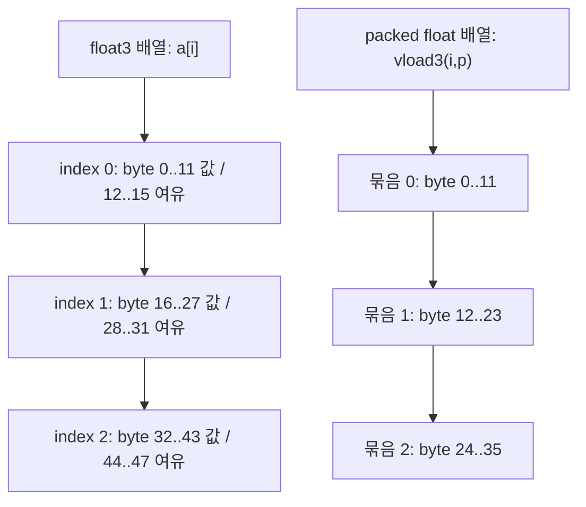

세 칸짜리 도시락을 담는데 선반에는 네 칸짜리 자리를 예약한다고 생각해 보자. 먹을 반찬은 세 개여도, 다음 도시락은 네 칸 뒤에서 시작한다. OpenCL C의 `float3`도 **값의 성분 수는 3, 배열 원소가 차지하는 크기는 16바이트**다.

최근 복습에서 `float3` 배열의 index 2 위치를 `4 × 3 × 2 = 24`바이트로 계산한 사례가 있었다. 여기서 **index 2를 세 번째 원소로 읽은 것은 맞다.** 고칠 부분은 0-based 인덱싱이 아니라, 성분의 총 바이트 수를 배열 stride로 그대로 사용한 한 단계다.

이 차이는 단순 암기 문제가 아니다. OpenCL → ANGLE → clspv/SPIR-V → Vulkan → AMDGPU 경로에서 buffer binding이 모두 정상이어도, shader가 다른 간격으로 주소를 만들면 틀린 원소를 읽는다. 오늘은 **성분 수·객체 크기·메모리에서 읽는 폭**을 나누어 본다.

## 먼저 확정된 코드 사실

아래는 Khronos OpenCL C 명세 소스 `OpenCL_C.txt`에서 직접 확인했다. 링크는 이동하는 `main`이 아니라 **commit `e3b43e80a9802ccc1d36954136dcb49b1b81105f`**에 고정했다. 특정 ANGLE/clspv 구현을 실측했다는 뜻은 아니다.

- **3-component vector의 크기는 성분 네 개분이다.** 원문: “For 3-component vector data types, the size of the data type is `4 * sizeof(component)`.” 한국어로는 “3-component vector의 타입 크기는 성분 타입 크기의 네 배”다. 같은 문단은 alignment도 그 경계라고 명시한다. 따라서 OpenCL C `float3`의 size와 alignment는 모두 16바이트다. Source: [OpenCL_C.txt, L1237–1247](https://github.com/KhronosGroup/OpenCL-Docs/blob/e3b43e80a9802ccc1d36954136dcb49b1b81105f/OpenCL_C.txt#L1237-L1247).
- **packed scalar 배열에는 별도의 load/store 경로가 있다.** 같은 문단은 `vload3`와 `vstore3`로 packed scalar 배열에서 3-component vector를 읽고 쓸 수 있다고 설명한다. “float3 값”과 “float3 배열의 저장 형식”은 같은 질문이 아니다. Source: [OpenCL_C.txt, L1244–1247](https://github.com/KhronosGroup/OpenCL-Docs/blob/e3b43e80a9802ccc1d36954136dcb49b1b81105f/OpenCL_C.txt#L1244-L1247).
- **`vloadn`의 offset은 scalar 하나가 아니라 n개 묶음 단위다.** 명세의 주소 식은 `p + (offset * n)`이다. `vload3(i, p)`에서 `p`가 `float*`이면 시작 주소는 `base + i × 3 × 4`바이트이고, 메모리에서 읽는 유효 데이터는 세 float다. 반환 타입의 size가 16이어도 16바이트 입력을 요구하는 식이 아니다. Source: [OpenCL_C.txt, L6985–7001](https://github.com/KhronosGroup/OpenCL-Docs/blob/e3b43e80a9802ccc1d36954136dcb49b1b81105f/OpenCL_C.txt#L6985-L7001).
- **alignment 조건도 구분한다.** 일반적인 unaligned load/store는 undefined behavior이며 vector load/store built-in은 명세가 정한 예외다. `float` 대상 `vloadn`의 계산된 주소는 32-bit aligned여야 한다. “packed를 읽는다”는 것이 아무 byte 주소나 허용한다는 뜻은 아니다. Source: [OpenCL_C.txt, L1251–1265](https://github.com/KhronosGroup/OpenCL-Docs/blob/e3b43e80a9802ccc1d36954136dcb49b1b81105f/OpenCL_C.txt#L1251-L1265), [L6997–7001](https://github.com/KhronosGroup/OpenCL-Docs/blob/e3b43e80a9802ccc1d36954136dcb49b1b81105f/OpenCL_C.txt#L6997-L7001).
- **`vstore3`도 세 성분만 쓴다.** `vstoren`은 `n * sizeof(gentype)`바이트를 같은 묶음 주소 식으로 쓴다. 세 성분을 가진 반환값을 얻었다고 네 번째 float를 packed 출력에 덧붙이지 않는다. Source: [OpenCL_C.txt, L7002–7017](https://github.com/KhronosGroup/OpenCL-Docs/blob/e3b43e80a9802ccc1d36954136dcb49b1b81105f/OpenCL_C.txt#L7002-L7017).

여기까지가 코드/스펙에서 직접 확인한 부분이다. 아래부터는 해석이다.

## 1. 12바이트라는 계산은 어디에서 맞을까

`float` 세 성분의 유효 데이터량은 12바이트다. 하지만 그 숫자가 모든 배치의 원소 간격은 아니다.

| 질문 | float3 배열 | packed float 배열을 vload3로 읽기 |
|---|---|---|
| 입력 pointer 타입 | `__global const float3 *a` | `__global const float *p` |
| 읽는 표현 | `a[i]` | `vload3(i, p)` |
| 논리적 값 | float 세 성분 | float 세 성분 |
| i에서 다음 묶음까지 | 16바이트 | 12바이트 |
| index 2의 시작 offset | 32바이트 | 24바이트 |
| 입력의 필요한 alignment | float3의 16바이트 경계 | float의 4바이트 경계 |

왼쪽은 **배열 원소 타입의 크기**를 따라 pointer arithmetic을 한다. 오른쪽은 `float*`에서 built-in이 `3*i`번째 scalar를 찾는다. 둘 다 결과를 `float3` 값으로 받을 수 있지만, 원본 데이터의 주소 계약이 다르다.

## 2. 같은 세 값, 다른 선반

두 저장 형식에서 각 묶음이 시작하는 byte offset을 나란히 놓으면 차이가 보인다.



그림의 화살표는 **주소가 증가하는 순서**이지 실행 시간이나 memory transaction 순서가 아니다. `float3` 쪽의 여유 공간은 네 번째 유효 성분도, 0으로 채워진다고 보장된 값도 아니다.

도시락 비유를 정확한 용어로 바꾸면 이렇다.

- 반찬 세 개 → `.x`, `.y`, `.z`의 세 성분.
- 네 칸짜리 예약 자리 → `sizeof(float3) = 16`인 배열 저장 공간.
- 세 칸씩 빈틈없이 놓인 선반 → scalar `float` 배열의 packed triples.
- 세 칸씩 집는 도구 → `vload3` / `vstore3`.

**비유의 한계:** 이 예약 공간은 CPU/GPU가 꼭 네 scalar load를 한다거나, 네 번째 lane이 계산에 참여한다는 뜻이 아니다. 객체 배치와 실제 ISA·memory transaction은 다른 층이다.

## 3. pointer cast는 데이터를 재포장하지 않는다

다음은 서로 다른 입력 레이아웃을 요구하는 두 kernel이다. 둘 다 각 묶음의 `.x`를 뽑지만 같은 host byte 배열을 무조건 공유할 수는 없다.

```c
__kernel void from_vec3(__global const float3 *a, __global float *out) {
    size_t i = get_global_id(0);
    out[i] = a[i].x;              // base + 16*i
}
__kernel void from_packed(__global const float *p, __global float *out) {
    size_t i = get_global_id(0);
    out[i] = vload3(i, p).x;      // base + 12*i
}
```

호출 측이 입력 묶음 수와 같은 GWS를 사용하고 입력·출력에 충분한 크기를 할당한다는 축약 예제다. padding 값을 검사하는 코드는 아니다.

host가 세 묶음을 `float packed[9]`로 만들었다면 유효 데이터는 36바이트다. 이것을 buffer로 복사하고 kernel 선언만 `float3*`로 바꾸어도 48바이트짜리 배열로 재포장되지 않는다. 세 번째 원소의 `.x`는 byte 32를 보므로 packed의 세 번째 묶음 시작(byte 24)이 아니라 그 묶음의 `.z`를 가리킨다. `.y`와 `.z`까지 읽는다면 원래 36바이트 범위 밖으로 나간다.

반대로 host가 각 레코드마다 float 네 개분을 예약했다면 `vload3(i, p)`를 그대로 쓰는 것도 맞지 않는다. 그 함수는 여전히 12바이트씩 전진한다. 그 배치에서 세 성분만 읽으려면 scalar pointer 기준으로 `vload3(0, p + 4*i)`처럼 **별도로 16바이트 레코드 시작점을 계산**할 수 있다.

요점은 “cast 금지”라는 구호가 아니다. **cast는 layout 변환이 아니다.** 타입을 바꾼 뒤의 주소 계산과 alignment·범위·타입 접근 조건을 따로 만족시켜야 한다.

host C/C++의 임의 `struct { float x, y, z; }`도 OpenCL C의 `float3` ABI를 저절로 상속하지 않는다. 실제 host 타입의 `sizeof`, alignment, 배열 stride를 확인하고 wire layout을 명시한다. kernel 쪽 size와 host 쪽 size를 같은 이름만 보고 동일시하지 않는다.

## 4. ANGLE/clspv에서 보존해야 할 것은 무엇인가

이 문제를 Android + AMDGPU stack으로 가져가면, 첫 질문은 “PM4가 잘못됐나?”가 아니라 **“소스가 요구한 실효 주소가 보존됐나?”**다.

개념적인 검증 목표는 다음과 같다.

```text
OpenCL a[i].x          -> input base + 16*i
OpenCL vload3(i,p).x   -> input base + 12*i
```

clspv가 내부에서 vector를 scalar화하거나 다른 표현으로 바꾸더라도 관찰 가능한 결과는 이 주소 계약과 같아야 한다. 따라서 SPIR-V에 3-component vector 타입이 보인다는 사실만으로 buffer stride 12를 결론내리면 안 된다. 반대로 항상 `ArrayStride 16`이라는 장식 하나가 있어야 한다고 고정해서도 안 된다. **실제 storage representation에 맞추어** decoration·access chain·scalar 주소 산술을 함께 읽어야 한다.

Vulkan capture에서 descriptor의 `buffer`, `offset`, `range`가 의도와 맞더라도 그 검사는 대개 **어느 buffer 영역을 노출했는가**에 관한 것이다. 그 안에서 i번째 레코드를 12로 찾는지 16으로 찾는지까지 descriptor binding 성공이 증명하지는 않는다. 이는 예전 글의 schema/value 구분에서 한 걸음 더 들어간, **resource 내부 주소 ABI**의 문제다.

AMD backend에서 실제 load 명령이 어떻게 합쳐지거나 나뉘는지는 그다음 질문이다. stride 16이라고 무조건 128-bit load 하나가 나온다거나, packed면 무조건 느리다고 말할 수 없다. 최적화로 사용하지 않는 성분의 load가 사라질 수도 있다.

**이번 글에서는 실제 Android ANGLE/clspv revision의 생성 SPIR-V, Vulkan capture, AMD ISA·PM4를 확인하지 못했다.** 위 내용은 소스 계약에서 도출한 진단 기준이며, 특정 버전이 잘못 낮춘다는 관측 보고가 아니다.

## 5. 값이 어긋날 때 확인할 네 가지 증거

1. **host bytes:** 레코드가 12바이트 간격인지 16바이트 간격인지 먼저 적는다. buffer 총 크기만 보지 말고 각 레코드의 시작 offset을 표시한다.
2. **kernel 표현:** `float3*` 인덱싱인지 `float*`의 `vload3`인지 확인한다. 유효 성분 수가 같다는 이유로 서로 교체하지 않는다.
3. **SPIR-V와 Vulkan state:** 같은 입력과 kernel에 대해 실제 주소 식과 descriptor base/range를 함께 확인한다. ABI 불일치와 잘못된 binding은 분리한다.
4. **backend 증거:** 앞의 의미가 맞는데도 결과가 틀리면 compiler 옵션·target·ISA 및 실행 결과를 연결한다. PM4 dispatch 성공만으로 shader 내부 주소 계산을 검증하지 않는다.

작은 확인 실험을 만든다면 위 예제의 출력을 세 성분으로 확장한다. 레코드마다 `(10*i, 10*i+1, 10*i+2)`를 넣고 `.x/.y/.z`를 각각 scalar 출력으로 꺼낸다. packed 입력과 padded 입력을 따로 준비해 두 kernel의 결과를 비교한다. padding은 의미 있는 네 번째 값으로 채점하지 않는다. **이는 재현 실험 제안이며 이번 글에서 실행한 결과는 아니다.**

## 수정된 모델과 전이 문제

- **처음의 기술 모델:** 성분 세 개 × 4바이트이므로 `float3` 배열 stride는 12, index 2는 byte 24다.
- **충돌한 사실:** OpenCL C는 3-component vector의 size/alignment를 성분 네 개분으로 정한다.
- **수정된 모델:** `float3 a[]`의 index 2는 byte 32다. packed `float p[]`의 `vload3(2,p)`는 byte 24다. 둘의 계산은 **서로 다른 저장 계약에서 각각 옳다.**

전이 문제: `vload3(2,p)`를 읽어 `float3 t`에 넣었다. 다음 packed 묶음은 16바이트 뒤에서 읽어야 할까? **아니다.** 반환값의 타입 크기와 입력 묶음의 간격은 별개다. `vload3(3,p)`는 base에서 36바이트, 앞 묶음보다 12바이트 뒤에서 시작한다. `t`를 별도의 `float3` 배열에 저장한다면 그 **출력 배열**의 원소 간격은 다시 16바이트다.

---

## 관련 글

- [ANGLE descriptor row 추적: schema는 맞는데 value가 틀릴 때]()
- [global_work_offset은 work-group을 빼지 않는다]()

## 관련 용어

- [[clspv]], [[SPIR-V]], [[descriptor-set]]
