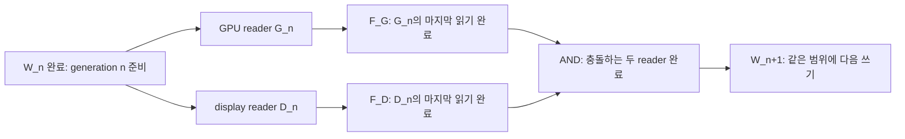

같은 도면을 설계팀과 인쇄팀이 보고 있다. 설계팀이 “다 봤다”고 연락했다고 원본을 다음 도면으로 덮어쓰면, 아직 읽는 인쇄팀은 앞부분과 뒷부분이 다른 도면을 가져갈 수 있다.

여기서 도면은 **같은 backing의 같은 겹치는 바이트 범위**, 설계팀은 GPU reader, 인쇄팀은 display reader다. 연락은 각 작업의 완료를 나타내는 fence에 대응한다. 중요한 건 연락이 하나 왔느냐가 아니라, **다음 쓰기와 충돌할 모든 접근이 끝났느냐**다.

이번 글은 공유 메모리를 이해한 다음 남는 경계, 즉 **읽기 중 덮어쓰기의 위험에서 reader별 완료의 합류로 넘어가는 지점**을 정리하는 오답노트다. “GPU가 끝나면 재사용 가능”을 일반 규칙으로 삼는 모델을 바로잡는다. 이 명제를 누군가 실제로 답했다고 단정하는 기록은 아니다.

## 먼저 확정된 코드 사실

아래 Linux 근거는 **v6.12** 태그 기준이다. OpenCL 사양은 확인한 commit에 고정했다. 특정 Android 제품의 kernel branch나 실행 trace를 확인한 것은 아니다.

- Linux의 `enum dma_resv_usage`는 `KERNEL < WRITE < READ < BOOKKEEP` 순서이며, 어떤 usage로 조회하면 그보다 낮은 usage도 포함한다고 명시한다. `READ` 조회는 기존 `READ`뿐 아니라 `WRITE`와 `KERNEL` fence도 포함한다. [include/linux/dma-resv.h:52–64](https://github.com/torvalds/linux/blob/v6.12/include/linux/dma-resv.h#L52-L64)
- `dma_resv_usage_rw(bool write)`는 새 write에 `DMA_RESV_USAGE_READ`, 새 read에 `DMA_RESV_USAGE_WRITE`를 반환한다. 주석의 원문은 **“new write operations needs to wait for the existing read and write operations to finish.”** 즉 새 writer는 기존 reader와 writer가 끝날 때까지 기다려야 한다. 새 reader는 기존 writer 완료를 기다린다. [include/linux/dma-resv.h:119–136](https://github.com/torvalds/linux/blob/v6.12/include/linux/dma-resv.h#L119-L136)
- `dma_resv_wait_timeout`은 지정한 usage로 fence를 순회하고 각 fence에 `dma_fence_wait_timeout`을 호출한다. 대기 자체의 반환값은 중단 시 음수, timeout이면 0, 성공이면 양수다. 이 반환값을 작업 결과의 무오류 판정과 동일시하면 안 된다. [drivers/dma-buf/dma-resv.c:664–696](https://github.com/torvalds/linux/blob/v6.12/drivers/dma-buf/dma-resv.c#L664-L696)
- `dma_buf.resv`의 문서는 **implicit synchronization을 지원하는 driver**에 대해 read/write fence 등록 규칙과 `dma_resv_usage_rw()`를 통한 dependency 조회를 설명한다. 공유 fd만 있으면 모든 API의 접근이 자동 등록된다는 보장은 아니다. [include/linux/dma-buf.h:381–408](https://github.com/torvalds/linux/blob/v6.12/include/linux/dma-buf.h#L381-L408)
- 같은 enum의 `DMA_RESV_USAGE_BOOKKEEP`는 “No implicit sync”이며 explicit-sync submission 등도 용도로 열거한다. 따라서 reservation에 fence가 있다는 사실과 implicit dependency에 포함된다는 사실은 다르다. [include/linux/dma-resv.h:102–116](https://github.com/torvalds/linux/blob/v6.12/include/linux/dma-resv.h#L102-L116)
- OpenCL의 `clFinish` 보장은 **지정한 command queue의 이전 command들**에 대한 것이다. 원문: **“All previously queued OpenCL commands in _command_queue_ are issued to the associated device, and the function blocks until all previously queued commands have completed.”** 즉 해당 큐에 앞서 들어간 명령들을 내보내고 그 완료까지 기다린다. 이 문장만으로 별도 display reader의 완료까지 보장되지는 않는다. [api/opencl_runtime_layer.asciidoc:14644–14651](https://github.com/KhronosGroup/OpenCL-Docs/blob/cc49096c39caad4edc395b80838da1025aa3c187/api/opencl_runtime_layer.asciidoc#L14644-L14651)

**여기까지가 코드/스펙에서 직접 확인한 부분이다. 아래부터는 해석이다.**

이하 시간값과 두-reader 구성은 설명용 가정이다. 실제 ANGLE의 외부 메모리 import, Vulkan interop, Android buffer handoff, AMDGPU submit 경로를 측정해 재현한 결과가 아니다.

## 1. 처음 모델 → 충돌한 사실 → 수정한 모델

- **처음 모델:** 이 buffer를 쓰던 GPU 작업이 끝났으니 다음 내용을 써도 된다.
- **충돌한 사실:** 같은 backing을 display도 읽고 있다면 GPU 완료는 display의 마지막 읽기를 증명하지 않는다. Linux의 새 writer dependency 규칙도 기존 read와 write를 함께 포함한다.
- **수정한 모델:** 다음 writer와 충돌하는 모든 기존 접근을 모으고, 그 완료에서 다음 쓰기까지 dependency를 연결한다. 그 뒤에도 새 reader가 끼어들지 않게 사용권 handoff를 지켜야 한다.

“모두 끝나야 한다”는 CPU가 fence마다 blocking wait를 호출해야 한다는 뜻은 아니다. driver나 queue가 다음 작업의 dependency로 걸고 CPU는 다른 일을 할 수 있다. **기다리는 주체와 지켜야 하는 순서는 별개**다.

## 2. GPU 완료와 display 완료는 두 개의 명제다

가정을 좁혀 보자. `B`의 내용 generation은 `n`이고, producer의 쓰기는 이미 끝났다. GPU reader `G_n`과 display reader `D_n`은 같은 범위를 읽는다. 그 밖의 사용자는 없고 다음 producer `W_(n+1)`가 그 범위를 덮어쓴다.



그림의 합류는 **특정 merge API나 단일 fence 객체의 존재가 아니라 두 dependency를 모두 만족해야 한다는 논리**다. producer 완료에서 reader 시작으로 이어지는 화살표도 실제 구현에서는 적절한 synchronization·visibility가 필요하다.

가령 `F_G`는 4ms에, `F_D`는 11ms에 완료된다고 하자. 5ms에 buffer를 덮으면 GPU에는 이미 늦은 사건이지만 display에는 아직 진행 중인 데이터 변경이다. 두 reader만 있고 추가 조건이 없다는 가정에서 재사용의 가장 이른 후보 시점은 `max(4, 11) = 11ms`다. 두 시간을 더한 15ms가 아니다. 병렬 reader의 **AND 합류**이기 때문이다.

반대로 display가 먼저 끝나고 GPU가 나중에 끝나도 규칙은 같다. “GPU fence냐 display fence냐” 중 하나를 고르는 문제가 아니다.

주의할 점은 fence의 이름보다 **그 signal이 무엇의 끝을 뜻하는가**다. buffer가 준비됐다는 신호, display에 전달됐다는 신호, 새 화면으로 전환됐다는 신호, 이전 buffer의 마지막 사용이 끝났다는 신호를 구별해야 한다. 여기서 `F_D`는 오직 **이 generation의 이 buffer를 더 읽지 않는다는 계약을 가진 완료**를 가정한다. 임의의 present/commit 알림을 대신 꽂으면 그림의 전제가 깨진다.

## 3. dma_resv의 READ/WRITE가 반대로 보이는 이유

`dma_resv_usage_rw(true)`가 `READ`를 돌려주는 코드를 처음 보면 “쓰려는데 왜 READ?”가 된다. 핵심은 **등록할 작업의 종류**와 **조회할 선행 dependency의 범위**가 다르다는 데 있다.

| 구분 | 새 reader | 새 writer |
|---|---|---|
| 새 작업을 나타내는 implicit fence 등록 usage | `READ` | `WRITE` |
| 기존 fence를 조회하는 helper 결과 | `WRITE` | `READ` |
| 조회에 포함되는 기존 usage | `KERNEL`, `WRITE` | `KERNEL`, `WRITE`, `READ` |
| 데이터 hazard 관점 | 기존 쓰기가 끝나야 읽음 | 기존 읽기·쓰기가 끝나야 덮음 |

새 reader끼리는 데이터가 바뀌지 않으므로 이 모델에서는 read-after-read 대기가 필요 없다. 새 writer는 기존 reader의 read-after-write가 아니라 **write-after-read 위험**도 막아야 한다. 그래서 조회 범위가 넓다.

이 표는 implicit-sync 규칙에 참여하고 fence가 올바르게 등록된 경우의 설명이다. `BOOKKEEP` fence를 `READ` 조회가 모두 기다려 준다고 읽으면 안 된다. 또한 이 helper가 존재한다는 사실만으로 모든 display 경로가 정확히 이 helper를 호출한다고 결론 내릴 수 없다.

## 4. fence 둘을 읽어 보니 완료였다 — 이것만으로도 부족할 수 있다

다음 순서는 여전히 위험하다.

```text
CPU: G_n과 D_n 완료를 확인
다른 thread: 같은 B에 새 reader R을 등록/제출
CPU: B를 다음 generation으로 덮어씀
```

완료를 확인한 집합과 실제 덮어쓸 때의 사용자 집합이 달라졌다. **완료 집합의 확인과 다음 사용권 획득 사이가 열린 것**이다.

따라서 합류 모델은 buffer pool의 ownership/handoff 규약과 함께 써야 한다. 앞의 두-reader 예는 새 reader가 추가되지 않는 구간이라는 가정을 포함한다. 실제 구현에서는 reservation 갱신·dependency 수집·submission을 관련 locking 및 API 프로토콜에 맞춰 연결해야 한다. 여기서 몇 줄의 가짜 kernel locking 코드로 모든 driver에 통하는 처방을 제시하지는 않는다.

generation도 중요하다. “B의 fence”라고만 적으면 이전 프레임 완료와 다음 프레임 준비가 섞인다. 로그에는 `B, generation n, read/write, producer/consumer, fence identity`를 함께 남겨야 어느 사용의 끝인지 추적할 수 있다. fd 번호나 GPU virtual address 하나만으로 backing과 generation 동일성을 증명하지 않는다.

## 5. OpenCL → Vulkan → AMDGPU에서 어디까지 증명할까

이 문제의 출발은 OpenCL command의 완료지만, 결론은 외부 consumer까지 포함한 재사용 계약이다. 층마다 질문을 하나씩 둔다.

1. **OpenCL:** `clFinish(q)` 또는 event가 어떤 command 집합을 포함하는가? 다른 queue나 display 완료가 dependency로 실제 연결돼 있는가? 같은 `cl_mem`처럼 보인다는 이유만으로 연결을 가정하지 않는다.
2. **ANGLE/Vulkan interop:** 외부 backing의 import와 synchronization 전달은 각각 어디서 이루어지는가? memory handle의 공유, semaphore/fence 전달, 필요한 visibility·ownership/layout 처리는 서로 다른 증거다. 일반 `vkCmdPipelineBarrier` 하나가 외부 display reader 완료를 만들어 주지는 않는다.
3. **clspv/SPIR-V:** shader의 읽기·쓰기 동작과 interface를 추적할 수 있지만, shader만 보고 display handoff가 완성됐다고 증명할 수는 없다. 두-reader 완료 합류는 kernel 코드 바깥의 문제다.
4. **Linux/AMDGPU:** 사용 branch에서 어떤 access가 어떤 usage의 reservation fence 또는 explicit dependency로 표현되는지 확인한다. `dma_resv` 구조만 보는 것보다 실제 등록자와 dependency 소비자를 함께 추적해야 한다.
5. **PM4/실행:** 특정 compute 작업의 종료 증거까지 내려갔더라도 별도 display 엔진의 마지막 읽기 증거를 자동으로 얻은 것은 아니다. packet 한 개의 완료를 buffer 전체 생애의 완료로 확대하지 않는다.

이 목록은 **조사 순서**이지 이번 글에서 모든 경로를 확인했다는 보고가 아니다. 특히 실제 Android stack의 ANGLE 외부-memory 지원 범위, sync-file 전달 경로, display release 의미, AMDGPU packet trace는 이번에 확인하지 못했다. 제품 branch의 코드와 trace가 있어야 좁힐 수 있다.

## 6. CPU 재사용은 cache 문제도 따로 남는다

모든 reader가 끝나도 CPU가 마음대로 mmap 영역에 쓰면 된다고 일반화하지 않는다. CPU 접근에는 exporter와 API가 요구하는 접근 구간·cache coherency 처리가 별도로 있다. Linux dma-buf 문서는 mmap 사용자의 CPU 접근을 `DMA_BUF_IOCTL_SYNC`로 둘러싸야 한다고 설명한다. [include/linux/dma-buf.h:247–259](https://github.com/torvalds/linux/blob/v6.12/include/linux/dma-buf.h#L247-L259)

즉 **실행이 겹치지 않게 하는 dependency**, **접근권 handoff**, **데이터가 올바르게 보이게 하는 coherency 처리**를 하나의 “fence 됐음”으로 뭉치면 안 된다. 반대로 cache sync 호출만으로 모든 GPU/display 작업의 완료 합류가 해결된다고 가정해서도 안 된다.

도면 비유는 마지막 reader를 기다리는 이유까지는 유용하지만 cache, memory visibility, buffer ownership, fence의 error 상태를 설명하지 못한다. fence가 terminal 상태라는 것과 산출물이 정상이라는 것도 별도 확인 대상이다.

## 디버깅 때 남길 최소 증거

“GPU 끝났음” 대신 다음 한 줄을 채울 수 있는지 본다.

> 이 backing의 generation n에 대해, 다음 쓰기와 충돌하는 사용자들은 누구이며, 각 마지막 접근의 완료를 어떤 dependency로 다음 writer에 연결했는가?

GPU reader만 찾았다면 display가 빠졌는지 본다. fence 둘을 찾았다면 각각 어떤 사용의 완료인지 본다. 둘 다 끝났다면 중간의 새 사용자와 CPU coherency 조건을 본다. 재사용 허가는 단일 작업의 종료가 아니라 **충돌하는 접근 집합을 닫는 과정**이다.

---

## 관련 글

- [비동기 write가 반환됐는데, 다음 kernel은 어느 weights를 읽을까]()
- [ANGLE descriptor row 추적: schema는 맞는데 value가 틀릴 때]()

## 관련 용어

- [[command-queue]], [[barrier]]
