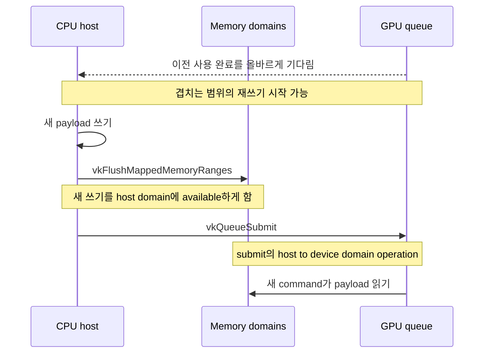

공용 도면을 고치려면 두 가지가 필요하다. 먼저 이전에 읽던 사람이 손을 떼야 한다. 그다음 내 책상에서 고친 내용을 공용 도면에 반영해야 한다. “이제 고쳐도 된다”는 연락이 왔다고, **그 연락 뒤에 내가 고친 내용까지 자동으로 전달되지는 않는다.**

업로드 buffer에서도 같은 구분이 필요하다. 이전 GPU 사용의 완료는 **다시 써도 되는 시점**을, non-coherent mapped memory의 flush는 **새 host 쓰기를 전달할 준비**를 다룬다. submit은 그 준비가 된 host 쓰기를 device 쪽 사용으로 연결한다.

이번 오답노트가 고칠 모델은 이렇다.

> 이전 GPU 작업을 기다렸고, CPU가 데이터를 쓴 뒤 새 작업을 submit했으니, GPU는 새 데이터를 읽을 것이다.

이 모델에는 조건 하나가 빠졌다. **HOST_VISIBLE이지만 HOST_COHERENT가 아닌 allocation에서는 새 쓰기 범위의 명시적 flush가 필요하다.** 완료 대기와 submit을 아무리 확실하게 해도 이 조건은 사라지지 않는다.

## 먼저 확정된 코드 사실

여기서는 특정 ANGLE 버전의 upload 구현이 아니라 **Khronos 사양 원문**을 확인했다. 링크는 조회 시점의 commit에 고정했으며 파일과 줄번호를 함께 적었다.

1. **non-coherent host 쓰기는 flush로 host memory domain에 available하게 해야 한다.** Vulkan `chapters/synchronization.adoc` L1742–1768은 HOST_COHERENT 유무에 따른 계약과 queue submission의 host→device domain operation을 구분한다. Source: [synchronization.adoc](https://github.com/KhronosGroup/Vulkan-Docs/blob/f0fe740e3ec9f3c060a5eb7ea11de0e2fdca85dc/chapters/synchronization.adoc#L1742-L1768).
2. **flush의 직접 보장은 host domain availability다.** `chapters/memory.adoc` L5404–5427은 `vkFlushMappedMemoryRanges`의 보장과 host happens-before 범위를 정의한다. Source: [memory.adoc](https://github.com/KhronosGroup/Vulkan-Docs/blob/f0fe740e3ec9f3c060a5eb7ea11de0e2fdca85dc/chapters/memory.adoc#L5404-L5427).
3. **submit의 host-write access scope에는 이미 host domain에 available한 쓰기가 들어간다.** `chapters/synchronization.adoc` L8402–8432. Source: [Host Write Ordering Guarantees](https://github.com/KhronosGroup/Vulkan-Docs/blob/f0fe740e3ec9f3c060a5eb7ea11de0e2fdca85dc/chapters/synchronization.adoc#L8402-L8432).
4. **host는 이전 device 접근을 동기화해야 하며, non-coherent 메모리에서는 atom 단위로 확장한 범위를 고려한다.** `chapters/memory.adoc` L5090–5110. flush가 포함하는 atom 전체도 synchronization 목적의 access로 간주된다(L5429–5440). Source: [mapping과 이전 접근](https://github.com/KhronosGroup/Vulkan-Docs/blob/f0fe740e3ec9f3c060a5eb7ea11de0e2fdca85dc/chapters/memory.adoc#L5090-L5110), [atom access](https://github.com/KhronosGroup/Vulkan-Docs/blob/f0fe740e3ec9f3c060a5eb7ea11de0e2fdca85dc/chapters/memory.adoc#L5429-L5440).
5. **flush 범위는 VkDeviceMemory 기준이고 alignment 제약이 있다.** 같은 파일 L5550–5584는 `offset`의 기준, mapping 안의 범위, `nonCoherentAtomSize` 배수와 allocation 끝 예외를 명시한다. unmap은 암묵적인 flush가 아니다(L5447–5450). Source: [VkMappedMemoryRange](https://github.com/KhronosGroup/Vulkan-Docs/blob/f0fe740e3ec9f3c060a5eb7ea11de0e2fdca85dc/chapters/memory.adoc#L5550-L5584), [unmap](https://github.com/KhronosGroup/Vulkan-Docs/blob/f0fe740e3ec9f3c060a5eb7ea11de0e2fdca85dc/chapters/memory.adoc#L5447-L5450).
6. **OpenCL clFlush는 queued command의 제출 진행을 다루며 완료를 보장하지 않는다.** OpenCL `api/opencl_runtime_layer.asciidoc` L14597–14615. Source: [Flush and Finish](https://github.com/KhronosGroup/OpenCL-Docs/blob/d920d07d948f92e39a2e757a7fc37acf5b19e23b/api/opencl_runtime_layer.asciidoc#L14597-L14615).

여기까지가 코드/스펙에서 직접 확인한 부분이다. 아래부터는 해석이다.

## 1. 처음 모델 → 충돌한 사실 → 수정된 모델

**처음 모델:** fence를 기다렸으므로 buffer가 동기화됐다. 새 submit까지 했으니 최신 내용도 보인다.

**충돌한 사실:** 이전 사용의 완료는 이후에 생긴 host 쓰기를 flush하지 않는다. submit이 잇는 대상도 무조건 모든 CPU store가 아니라, 사양의 access scope에 들어오는 **host domain에 available한 쓰기**다.

**수정된 모델:** 같은 buffer의 재사용을 세 단계로 증명한다.

- **이전 세대의 접근 종료:** 겹치는 범위를 아직 사용하는 GPU 등의 접근이 끝났는가?
- **새 세대의 host 쓰기 availability:** non-coherent이면 해당 쓰기를 적절한 범위로 flush했는가?
- **새 세대의 device 사용 연결:** 쓰기와 flush가 submit보다 happens-before이며, 새 작업의 resource·기타 의존성이 맞는가?

첫 단계가 끝나야 두 번째 단계의 쓰기를 안전하게 시작할 수 있다. 그렇다고 첫 단계가 두 번째 단계를 대신하지는 않는다. **“buffer가 동기화됐다” 대신 “어느 세대의 어느 접근을 무엇과 동기화했나”라고 물어야 한다.**

## 2. CPU → host domain → device 사용: 빠진 화살표 찾기

사양의 단어를 짧게 직접 보자.

> “made available to the host memory domain”
>
> `vkFlushMappedMemoryRanges`는 지정 범위의 host 쓰기를 **host memory domain에 available**하게 한다.

출처는 위 `memory.adoc` L5404–5409다. 이 문장은 “flush를 호출하면 GPU 작업이 완료된다”도, “다른 GPU 작업과의 모든 의존성이 해결된다”도 아니다.

submit 쪽에는 다음 조건이 있다.

> “all host writes to mappable device memory that are available to the host memory domain”
>
> submit의 첫 access scope에는 **이미 host domain에 available한** host 쓰기가 포함된다.

출처는 `synchronization.adoc` L8427–8429다. 두 문장을 연결하면 왜 submit만으로 non-coherent flush를 생략할 수 없는지 보인다.



**정적 읽기:** `이전 사용 완료 대기 → 새 CPU 쓰기 → non-coherent flush → submit → 새 device 접근`이다. flush를 지우면 이전 완료 대기와 submit 사이에 **새 쓰기의 host availability 근거**가 빈다.

이 그림은 단일 Vulkan device에서 유효하게 바인딩·mapping된 upload buffer를 가정한다. host 쓰기와 flush는 submit에 앞서며, 다른 thread가 동시에 바꾸지 않는다. staging copy 뒤 별도 destination을 shader가 읽는 경로, queue-family ownership, 외부 reader 동기화는 이 그림에 포함하지 않았다.

또한 memory domain은 사양의 추상 모델이다. 위 화살표를 “항상 CPU L1 → DRAM → GPU L2의 세 번 복사”로 읽으면 안 된다. 공용 도면 비유도 여기서 멈춘다. 실제 cache 구조·interconnect·flush 구현은 플랫폼에 따라 다르다.

## 3. fence 대기, flush, barrier를 바꿔 끼우면 안 되는 이유

### 완료 대기: 이전 사용자와의 겹침을 없앤다

이전 GPU reader를 포괄하는 fence를 host가 올바르게 기다렸다면, 그 reader와 CPU의 다음 쓰기가 겹치는 위험을 제거할 수 있다. 다만 다른 reader가 있으면 그 접근도 따로 포괄해야 한다. 지난 글의 GPU/display reader 합류가 이 부분이다.

이것은 **쓰기 허가**이지 **아직 하지도 않은 쓰기의 cache maintenance**가 아니다. 이때의 fence를 나중에 생긴 CPU store의 가시성 증거로 들면 시간축부터 맞지 않는다.

### flush: 새 host 쓰기의 availability를 만든다

non-coherent mapping을 수정한 뒤 `vkFlushMappedMemoryRanges`를 호출한다. flush는 GPU reader가 끝날 때까지 기다려 주는 수단이 아니다. 사용 중인 atom을 CPU가 덮거나 flush하면서 이전 사용의 완료를 생략하면, 가시성을 논하기 전에 충돌하는 access 문제가 생긴다.

### submit: 준비된 host 쓰기를 device 쪽 사용으로 연결한다

host store와 필요한 flush가 submit보다 happens-before인 일반적인 경로에서는 queue submission이 host→device domain operation을 수행한다. 따라서 **이 host 쓰기를 첫 device 접근으로 연결하려고만** 추가 `HOST_WRITE → SHADER_READ` barrier를 무조건 넣을 필요는 없다. 이 지점은 `synchronization.adoc` L1760–1768의 설명과 같다.

반대로 그 barrier를 넣었다고 non-coherent flush가 대체되지는 않는다. barrier의 host→device domain operation도 host domain에 available한 내용을 대상으로 한다.

주의할 경계는 있다. staging buffer를 copy한 뒤 destination을 compute shader가 읽는다면 `transfer write → compute shader read`는 **다른 device-side 의존성**이다. submit의 host-write 보장이 그 copy 결과의 후속 소비까지 모두 해결한다는 뜻은 아니다.

## 4. 실무에서 놓치기 쉬운 단위: buffer가 아니라 allocation의 atom

“flush했는데도 안 된다”면 함수 이름보다 `memory`, `offset`, `size`를 먼저 본다. `VkMappedMemoryRange.offset`은 **VkBuffer 시작점이 아니라 VkDeviceMemory 시작점 기준**이다.

계산 예시의 가정은 다음과 같다.

- allocation 전체가 mapping돼 있다.
- buffer binding offset `B = 4096` bytes.
- buffer 안의 CPU 수정 범위는 `[U, U+N) = [300, 500)` bytes.
- 예시 장치의 `nonCoherentAtomSize`, `A = 256` bytes.
- allocation 크기는 아래의 정렬된 끝점 이상이다.

그러면 allocation 기준 실제 수정 범위는 `[4396, 4596)`이고, flush가 덮을 범위는 이렇게 계산한다.

```text
writeBegin = B + U                       = 4396
writeEnd   = B + U + N                   = 4596
flushBegin = floor(writeBegin / A) * A   = 4352
flushEnd   = ceil(writeEnd / A) * A      = 4608
VkMappedMemoryRange: offset = 4352, size = 256
```

이 수치는 예시이지 AMDGPU 장치의 실제 atom 크기를 주장하는 것이 아니다. 실제 값은 해당 physical device의 limit에서 읽어야 한다. mapping 포인터가 allocation의 중간부터 시작한다면 CPU 포인터 산술도 mapping offset을 반영해야 한다.

일반화할 때는 세 가지를 더 확인한다.

1. 정렬 확장된 flush 범위가 현재 mapping 안에 있어야 한다. 부분 mapping 끝을 넘어 무작정 올림하면 안 된다.
2. `offset`은 atom 배수여야 한다. 명시적 `size`는 atom 배수이거나 `offset + size`가 allocation 끝이어야 하는 예외를 적용한다. `VK_WHOLE_SIZE`도 mapping 끝 조건을 확인해야 한다.
3. flush가 포함하는 atom 전체는 synchronization 관점에서 access로 취급된다. **바이트 범위가 안 겹치는 두 suballocation도 같은 atom을 공유하면 독립적으로 갱신해도 된다고 단정할 수 없다.**

예를 들어 256-byte atom의 앞 128 bytes는 frame A의 GPU reader가 사용하고, 뒤 128 bytes는 frame B용으로 CPU가 바꾼다고 하자. 논리적인 slot은 다르지만 atom은 같다. allocator의 slot 간격과 재사용 동기화를 함께 검토해야 한다. atom별로 생명주기를 분리하거나 같은 atom을 공유하는 access를 적절히 동기화하는 것이 설계 방향이다.

이건 cache line이 반드시 256 bytes라는 주장이 아니다. 여기서 atom은 **Vulkan이 노출하는 non-coherent synchronization granularity**다.

## 5. HOST_COHERENT와 unmap은 어디까지 해결하나

HOST_COHERENT인 allocation에서는 이 목적의 명시적 flush/invalidate가 필요 없다. 하지만 CPU가 아직 읽는 GPU와 동시에 같은 위치를 덮어도 된다는 뜻은 아니다. coherent는 완료 대기·resource 수명·host thread 간 happens-before를 없애지 않는다.

반대로 non-coherent mapping을 `vkUnmapMemory`하면 알아서 flush될 거라고 기대해서도 안 된다. 사양은 다음처럼 못 박는다.

> “Unmapping non-coherent memory does not implicitly flush the host mapped memory”
>
> non-coherent memory의 unmap은 mapped memory를 암묵적으로 flush하지 않는다.

따라서 persistent mapping인지 매번 map/unmap하는지보다, **어느 쓰기 세대의 어느 범위를 언제 flush했는지**가 중요하다. allocator의 upload helper가 flush를 대신 수행하는 구현이라면 raw API 호출을 또 넣기 전에 그 helper의 계약과 실제 범위를 확인한다. “직접 호출이 안 보인다”만으로 누락이라 단정하지도 않는다.

## 6. OpenCL → ANGLE → Vulkan → AMDGPU에서 무엇을 추적할까

이 구분을 OpenCL 앱에 그대로 API 의무로 떠넘기면 또 틀린다. 일반적인 `clEnqueueWriteBuffer`를 쓰는 OpenCL 앱이 내부 `VkDeviceMemory`를 찾아 직접 flush해야 하는 것은 아니다. 해당 runtime/backend가 OpenCL 계약을 Vulkan 자원 사용으로 구현해야 한다.

특히 **clFlush와 vkFlushMappedMemoryRanges는 이름만 비슷하다.** OpenCL `clFlush`는 command queue의 제출 진행을 다룬다. Vulkan의 mapped-memory flush는 host 쓰기의 availability를 다룬다. 전자를 호출했으니 후자가 수행됐다는 결론은 API 이름으로 증명할 수 없다.

디버깅 가설을 세운다면 다음 경계를 따라간다.

```text
OpenCL write / map-unmap 계약
  → runtime의 host 데이터 보존·복사·resource 수명 관리
  → Vulkan allocation의 memory property와 mapped range
  → 새 host write generation의 flush 또는 coherent 근거
  → submit ID와 실제 device 사용
  → device-side copy / shader dependency가 있으면 그 의존성
  → AMDGPU 제출·command stream의 실행 증거
```

clspv/SPIR-V의 정상적인 shader interface는 consumer가 어느 resource를 어떻게 접근하는지의 근거다. 그것만으로 host가 쓴 새 payload의 availability까지 증명할 수는 없다. 컴파일 성공과 올바른 descriptor 역시 이 빈칸을 채우지 않는다.

다음 항목을 같은 upload generation으로 묶으면 원인을 분리하기 좋다. 이는 **제안하는 로그 필드**이지 실제 ANGLE 로그 형식이 아니다.

```text
upload_generation=G42
resource / memory_id / buffer_binding_offset
host_write_range_memory_relative=[begin,end)
memory_type_flags / nonCoherentAtomSize
previous_use_completion_evidence
flush_range / flush_result_or_coherent_reason
host_happens_before_submit_evidence
submit_id / first_device_consumer
```

PM4 dispatch가 보인다는 것은 이 중 마지막 실행 쪽 증거다. **CPU 새 쓰기의 flush 누락을 특정 PM4 packet 하나가 자동 복구한다고 볼 근거는 없다.** host-side availability와 GPU 실행·cache action의 계약을 혼동하지 말아야 한다.

여기서는 실제 Android + ANGLE + AMDGPU의 source revision, memory type 선택, flush helper, PM4 dump를 확인하지 않았다. 따라서 “ANGLE은 항상 이 함수에서 flush한다”, “이 AMD packet이 반드시 나온다”는 구현 주장은 하지 않는다. 이 글이 확정한 것은 Vulkan 계약과 그 계약을 디버깅에 적용하는 구분이다.

## 마지막으로: 무엇을 기다렸고, 무엇을 전달했나

- **이전 사용 완료:** 이제 겹치는 범위를 다시 써도 되는가?
- **non-coherent flush:** 이번 host 쓰기가 host domain에 available한가?
- **submit과 필요한 device 의존성:** 그 쓰기를 소비할 작업으로 올바르게 이어졌는가?

“기다렸으니 보인다”가 아니라 **기다림 뒤에 새로 쓴 내용을 어떤 계약으로 전달했는가**까지 설명하면, 수명·순서·가시성이 서로의 대용품이 되지 않는다.

---

## 관련 글

- [GPU는 끝났는데 버퍼를 덮으면 왜 화면이 깨질까: 두 reader의 완료 합류]()
- [비동기 write가 반환됐는데, 다음 kernel은 어느 weights를 읽을까]()
- [ANGLE descriptor row 추적: schema는 맞는데 value가 틀릴 때]()

## 관련 용어

- [[command-queue]], [[command-buffer]], [[barrier]], [[ANGLE]], [[SPIR-V]]
